# Checkpoint 6 – Ecosistemas multimedia de audio (Voice AI)

Documento de entrega: [`PreEntrega_Modulo6_EnzoSaporiti.pdf`](PreEntrega_Modulo6_EnzoSaporiti.pdf)

## Caso de uso

Se agrega un **tercer canal** de atención al Manager: **notas de voz por Telegram**. El cliente graba su consulta y recibe la respuesta en audio. El agente responde las políticas de la tienda desde el manual (RAG del Módulo 5), con respuestas cortas pensadas para ser escuchadas.

## Circuito

```
[Telegram Trigger] → [IF ¿Nota de voz ≤ 60 s?] ─ No → [Aviso: solo notas de voz]
      ▼
[Descargar audio] → [Normalizar .ogg] → [Whisper STT (Groq · es)] ─ Error → [Aviso técnico]
      ▼
[IF ¿Transcripción válida?] ─ No → [Aviso: no te entendí]
      ▼
[Texto limpio (audio descartado)] → [Agente Voz (Tools Agent + RAG)] → [Contención 200 caracteres]
      ▼
[ElevenLabs · Multilingual v2] ─ Error → [Fallback en texto]
      ▼
[Telegram Send Audio] → [Payload sin binarios] → [Slack]
```

| Componente | Implementación |
|---|---|
| Oídos (STT) | Whisper `whisper-large-v3-turbo` servido por Groq (plan gratuito). Input Binary Property: `data`. Idioma: `es` |
| Cerebro | AI Agent (Tools Agent) con Claude Haiku 4.5 y la tool `Vector Store Retrieve Tool` (Worker 3) |
| Contención financiera | Regla de máximo 200 caracteres en el System Message, más un nodo que recorta si el modelo se excede |
| Voz (TTS) | Nodo oficial de ElevenLabs: `eleven_multilingual_v2`, Stability 0,6, Similarity Boost (Clarity) 0,8 |
| Contingencia | IF de entrada (no es voz o dura más de 60 s), IF posterior a Whisper (transcripción vacía), aviso técnico y fallback en texto |
| Compliance | Audio descartado después de la transcripción, ejecuciones de producción sin guardar, logs solo de texto |

## Archivos

- [`manager_modulo6_saporiti_enzo.json`](manager_modulo6_saporiti_enzo.json): Torque – Manager (M6), con los canales chat, email y voz.
- Los Workers 1, 2 y 3 son los del Módulo 5 ([`modulo5/`](../modulo5/)).

## Credenciales adicionales

| Credencial | Uso |
|---|---|
| **Telegram API** | Token del bot, creado con @BotFather |
| **Bearer Auth** | API key de Groq, para Whisper |
| **ElevenLabs** | API key dedicada al proyecto, con tope de créditos y desactivación automática si se filtra. Requiere una **voz predeterminada**: el plan gratuito no permite usar por API las voces de la Library |

## Pruebas

| # | Entrada | Resultado |
|---|---|---|
| 1 | Audio: "¿Cuánto tarda un envío a Mendoza?" | ✓ Respuesta en audio, 139 de 200 caracteres |
| 2 | Audio: "¿Me colocan la cadena si la compro?" | ✓ "No sé…" en audio, 75 de 200 caracteres |
| 3 | Audio sin voz útil | ✓ Contingencia: "No pude entender tu audio…" |
| 4 | Mensaje de texto | ✓ Aviso: el canal atiende notas de voz |
| 5 | Audio de 66 segundos | ✓ Aviso del máximo de 1 minuto, sin transcribir (costo cero) |

## Evidencia

**Zona 1 – Entrada y transcripción:**

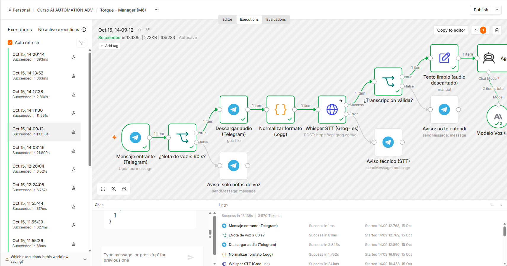

**Zona 2 – Agente, voz y salida:**

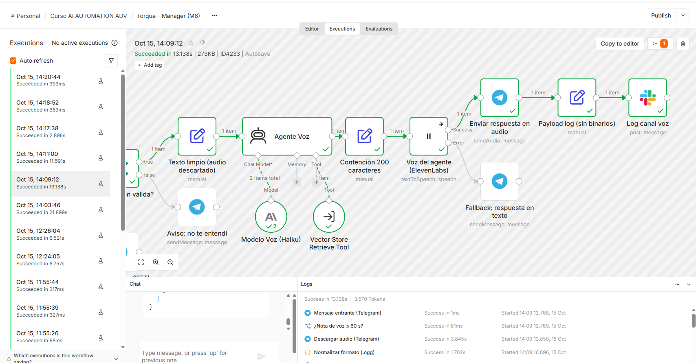

**Configuración de Whisper:**

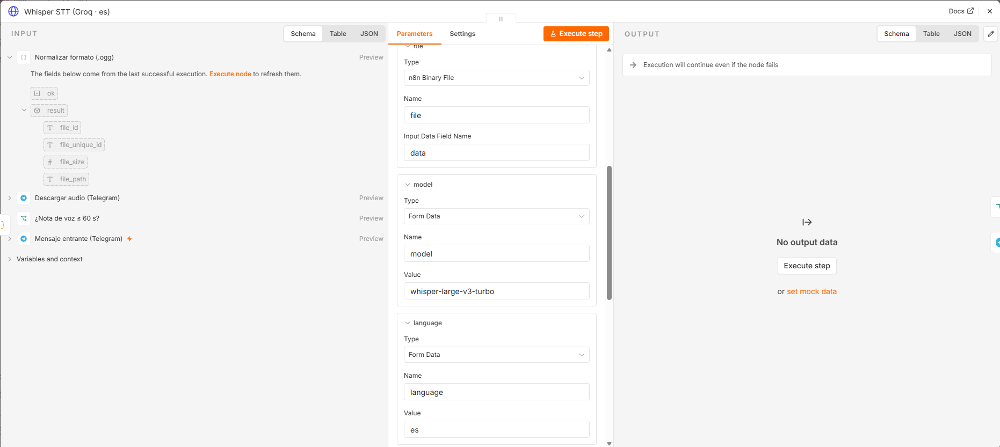

**System Prompt del agente de voz:**

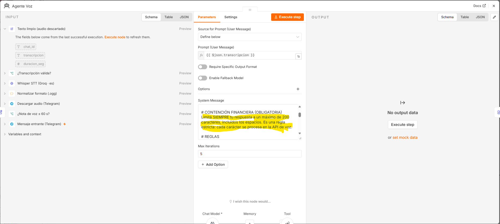

**Contención de 200 caracteres:**

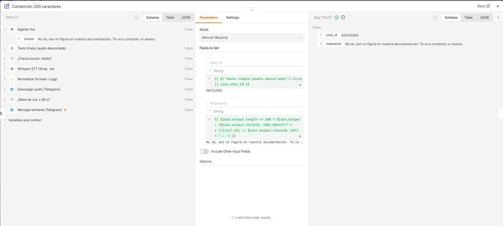

**Configuración de ElevenLabs:**

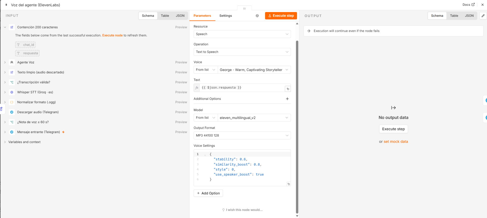

**Ejecución exitosa con respuesta en audio:**

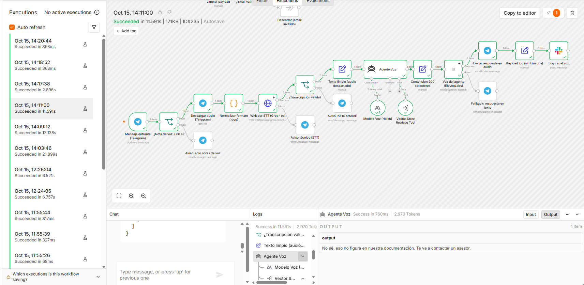

**Contingencia por transcripción inválida:**

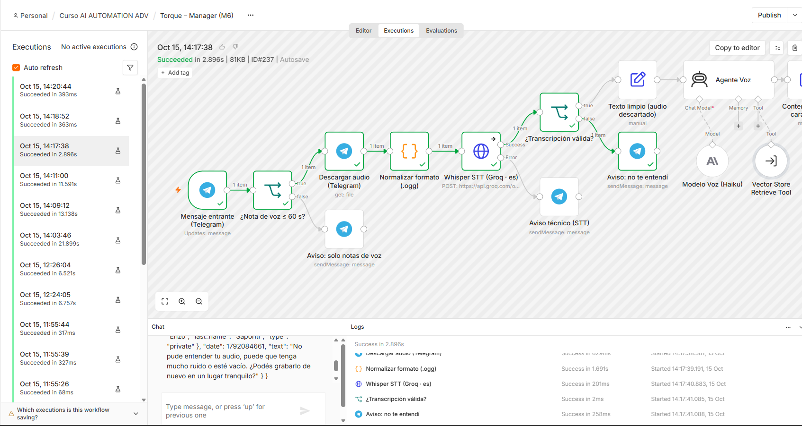

**Audio de más de 60 segundos:**

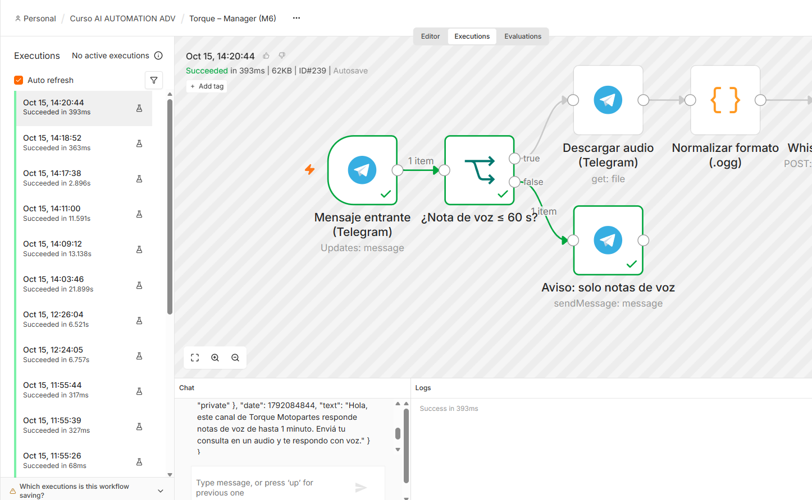

**Fallback en texto ante error de ElevenLabs:**

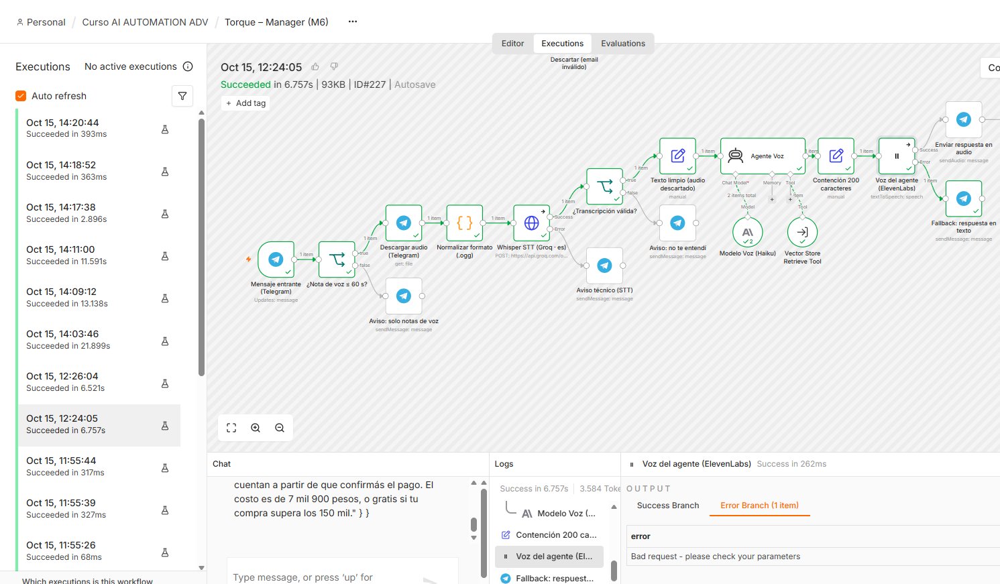

**Configuración de compliance:**

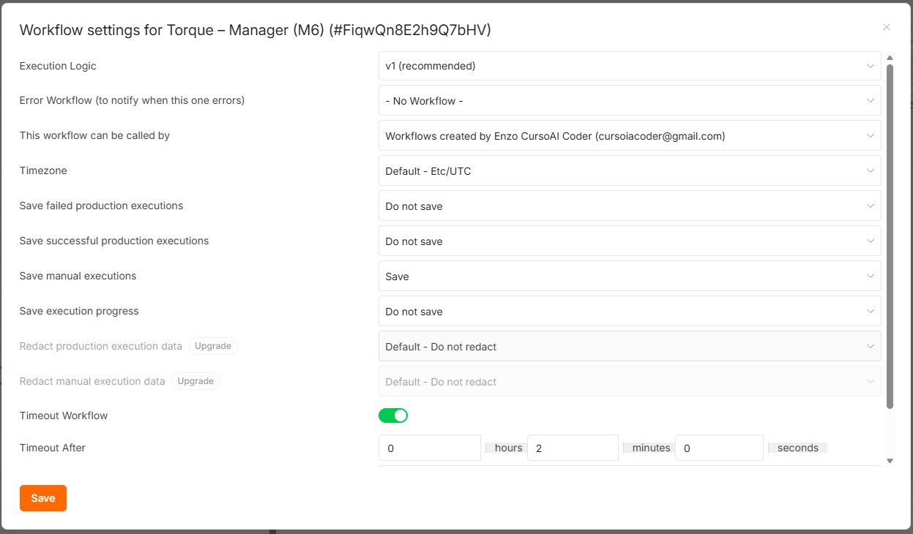

**Conversación en Telegram:**

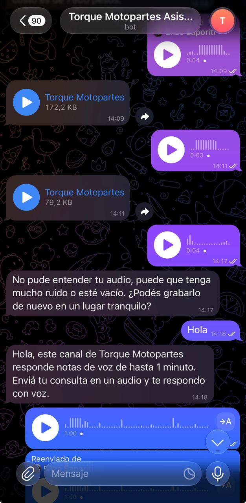

**Logs del canal voz en Slack:**

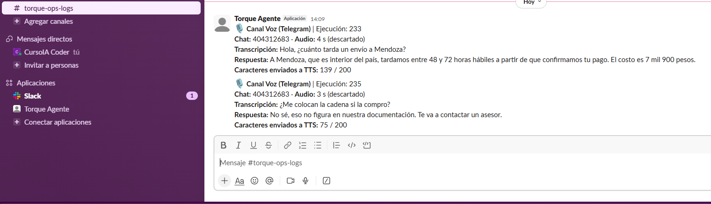

**API key de ElevenLabs:**

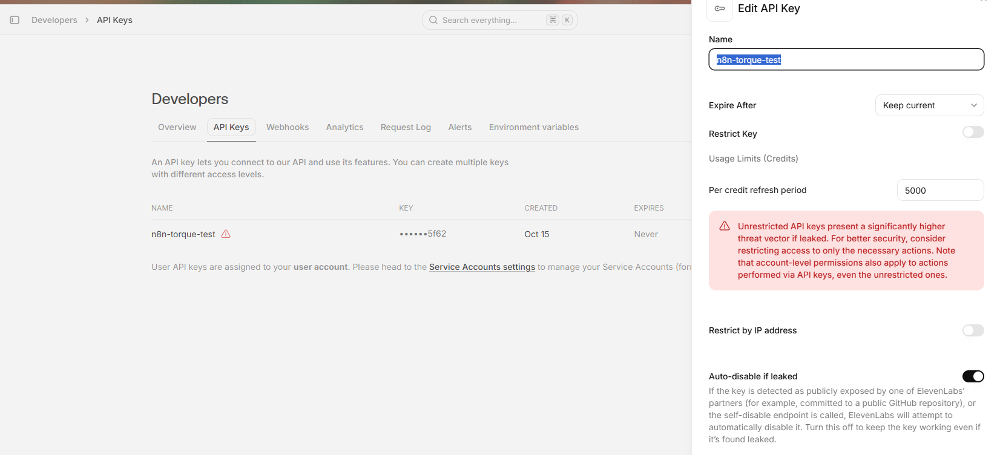
