# Checkpoint 8 – Supervisor QA con AI-as-a-Judge, test A/B y dashboard

Documento de entrega: [`Checkpoint_Modulo8_Saporiti_Enzo.pdf`](Checkpoint_Modulo8_Saporiti_Enzo.pdf)

## Arquitectura

```
[Formulario de prueba] → [Contexto del cliente (Airtable)] → [Agente (Worker 2)] → [Juez (Worker 4 · JSON Schema)]
      → [Registrar veredicto (Airtable)] → [Switch]
           ├ ACEPTADO (exactitud ≥ 4) → envío real (Telegram)
           ├ CORREGIR → la crítica vuelve al agente (máximo 1 reintento) → si no aprueba → humano
           └ RECHAZADO / fallback → pausa + Slack [Aprobar] [Editar]
```

| Archivo | Workflow |
|---|---|
| [`supervisor_qa_modulo8_saporiti_enzo.json`](supervisor_qa_modulo8_saporiti_enzo.json) | Torque – Supervisor QA (M8) |
| [`worker4_juez_modulo8_saporiti_enzo.json`](worker4_juez_modulo8_saporiti_enzo.json) | Torque – Worker 4 Juez de Calidad (Claude Sonnet 4.5, temperatura 0) |
| [`worker2_modulo8_saporiti_enzo.json`](worker2_modulo8_saporiti_enzo.json) | Torque – Worker 2 Redacción (modelo según la arquitectura del A/B y crítica del Juez) |
| [`auditoria_qa.csv`](auditoria_qa.csv) | Registro externo de todos los veredictos (tabla `Auditoria_QA` de Airtable) |

## Salida del Juez (JSON Schema)

- `exactitud_factual`: entero de 1 a 5.
- `estado_veredicto`: `ACEPTADO`, `CORREGIR` o `RECHAZADO`.
- `categoria_error` y `critica`: campos de soporte para la autocorrección y el dashboard.

## Resultados del A/B (Lote 1, 10 corridas)

| Indicador | A · Haiku 4.5 | B · Sonnet 4.5 |
|---|---|---|
| Precisión vs. ground truth (intento 1 → entregada) | 60% → 80% | 60% → 80% |
| Errores enviados al cliente sin revisión | 0 | 1 |
| HITL Rate | 20% | 20% |
| Tokens promedio del agente por caso | 4.702 | 3.703 |
| Costo por ejecución (agente + Juez) | USD 0,0189 | USD 0,0246 |
| Costo cada 1.000 ejecuciones | USD 18,87 | USD 24,64 |

Umbrales por criticidad: ≥ 4 en consultas informativas; exactitud 5 en devoluciones, reembolsos y datos sensibles; las acciones de escritura requieren siempre aprobación humana.

**Recomendación:** Arquitectura A, más controles deterministas en el Juez para las reglas literales. El detalle está en el PDF.

## Evidencia

**Supervisor QA, vista general:**

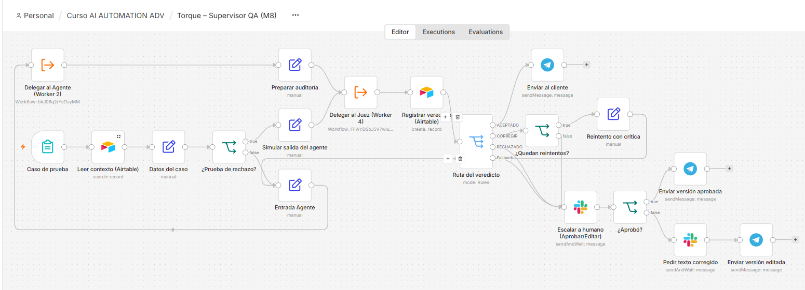

**Zona 1:**

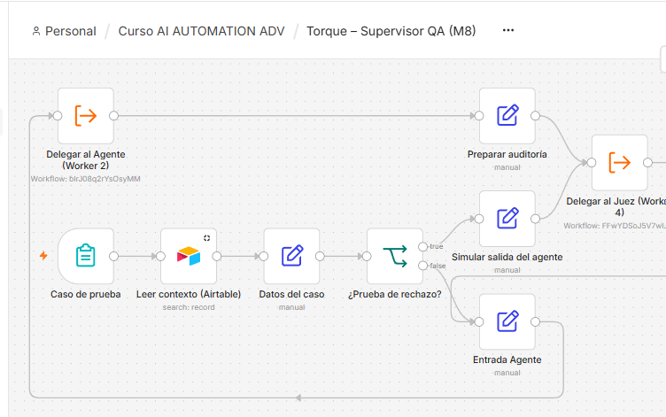

**Zona 2:**

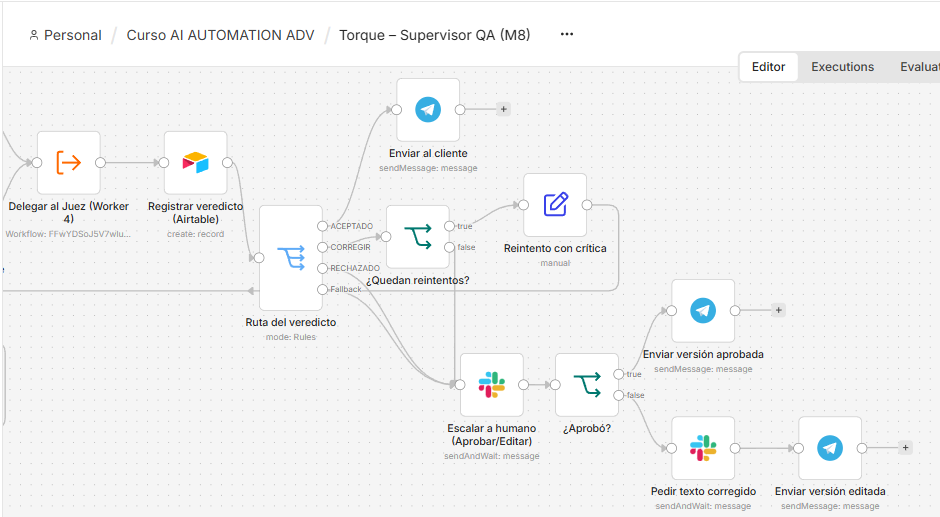

**Worker 4 (Juez):**

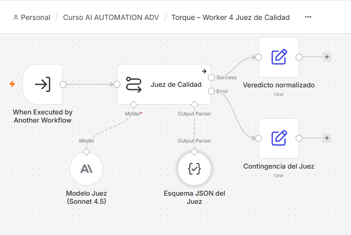

**Configuración del Juez:**

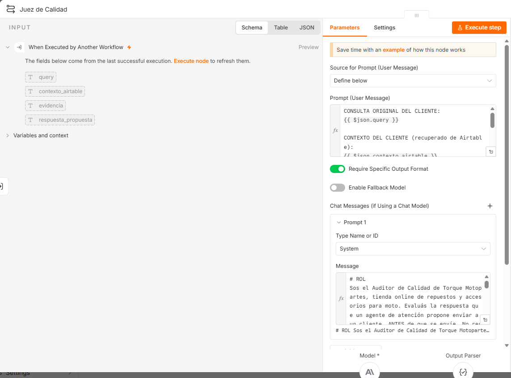

**Switch de 3 rutas:**

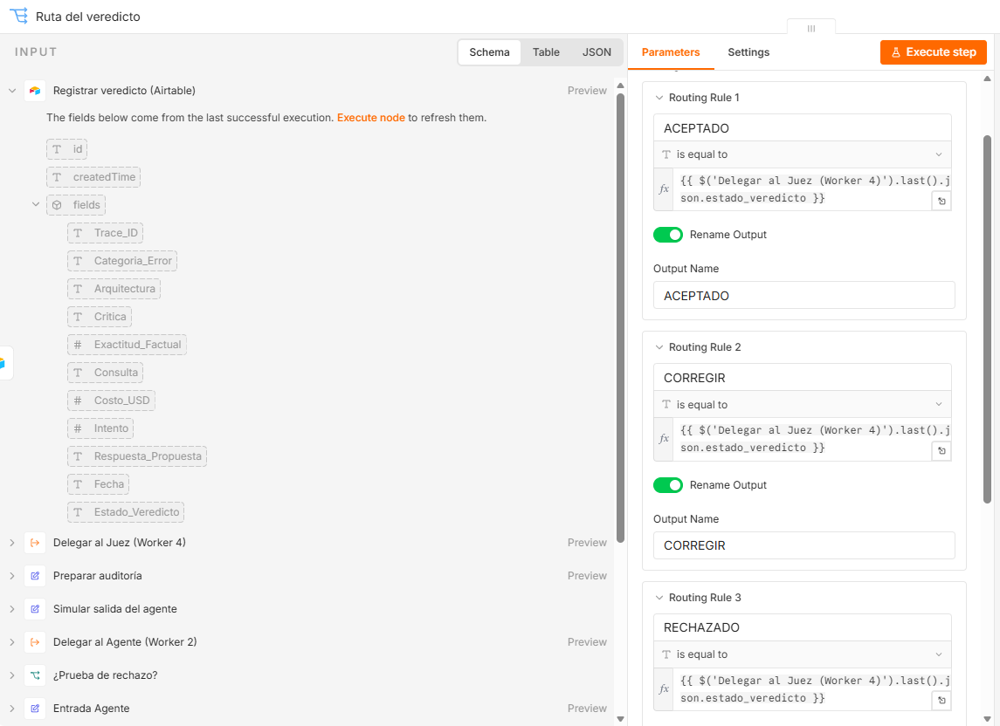

**Ruta ACEPTADO:**

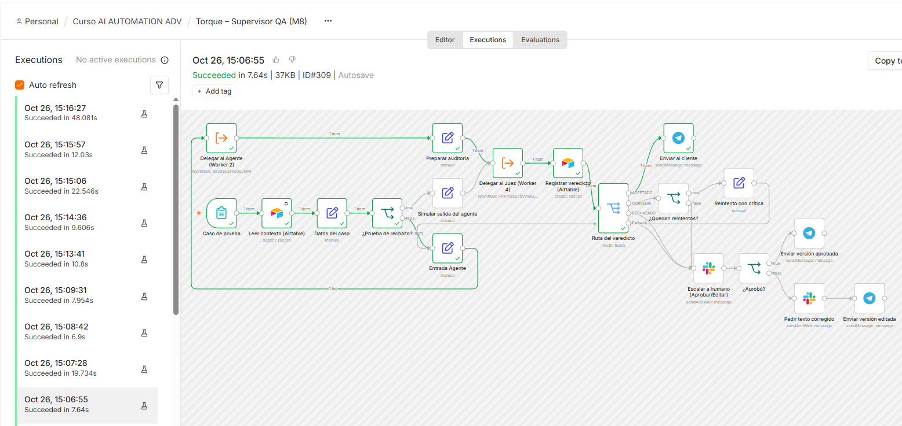

**Ruta CORREGIR:**

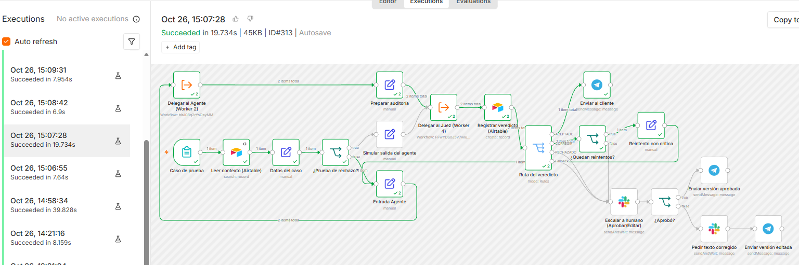

**Ruta RECHAZADO:**

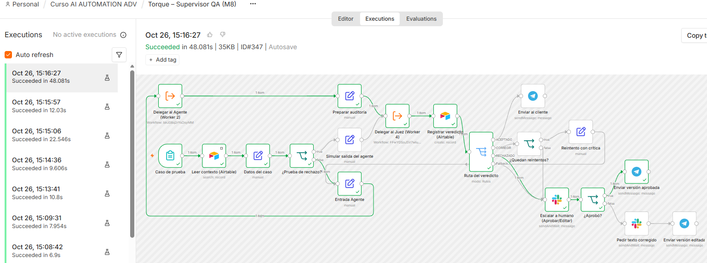

**Escalamiento en Slack:**

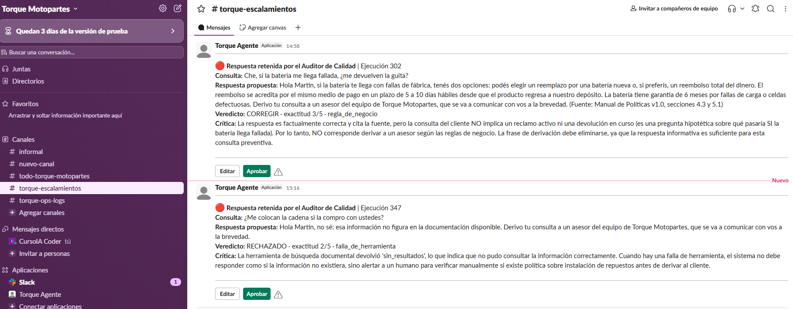

**Tabla de auditoría en Airtable:**

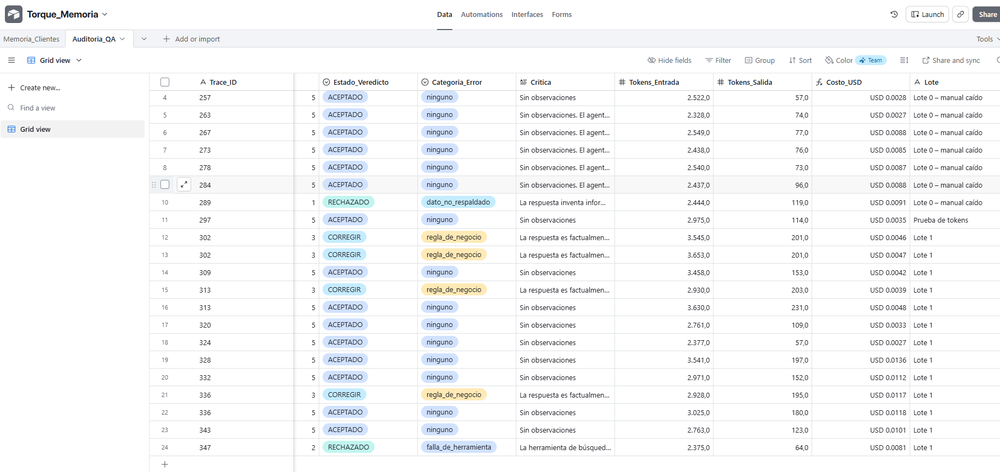
