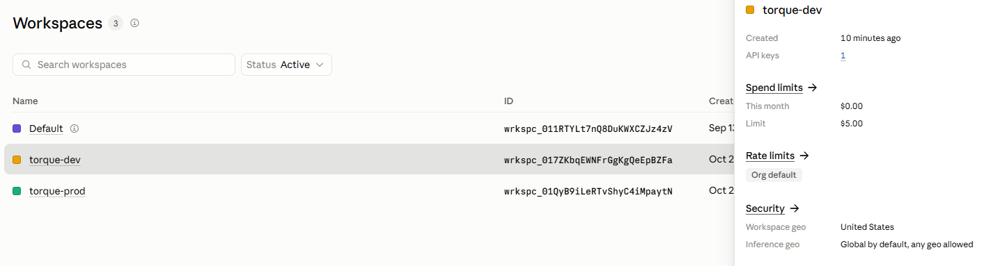
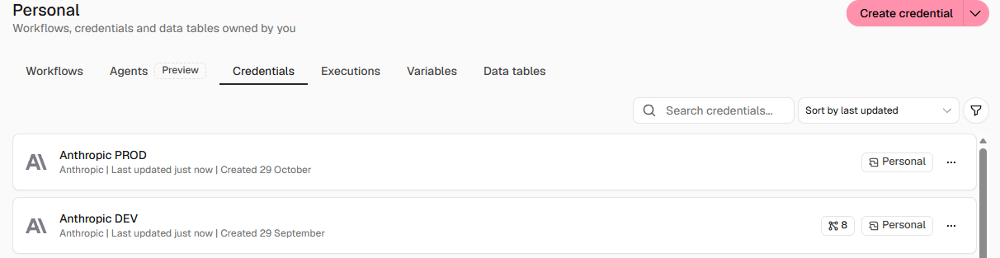
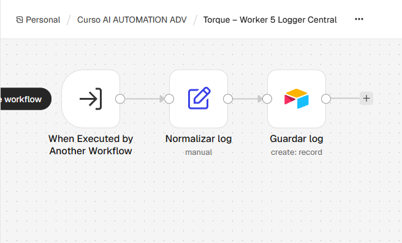
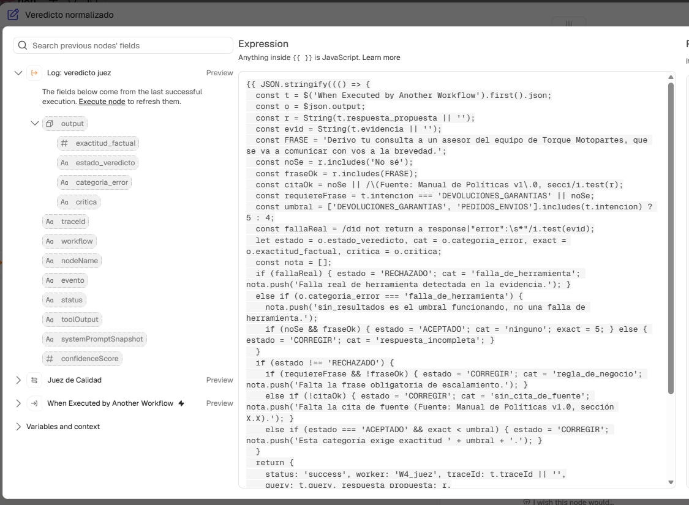
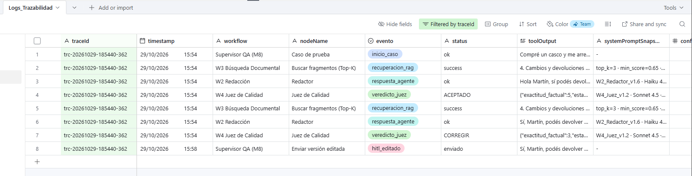
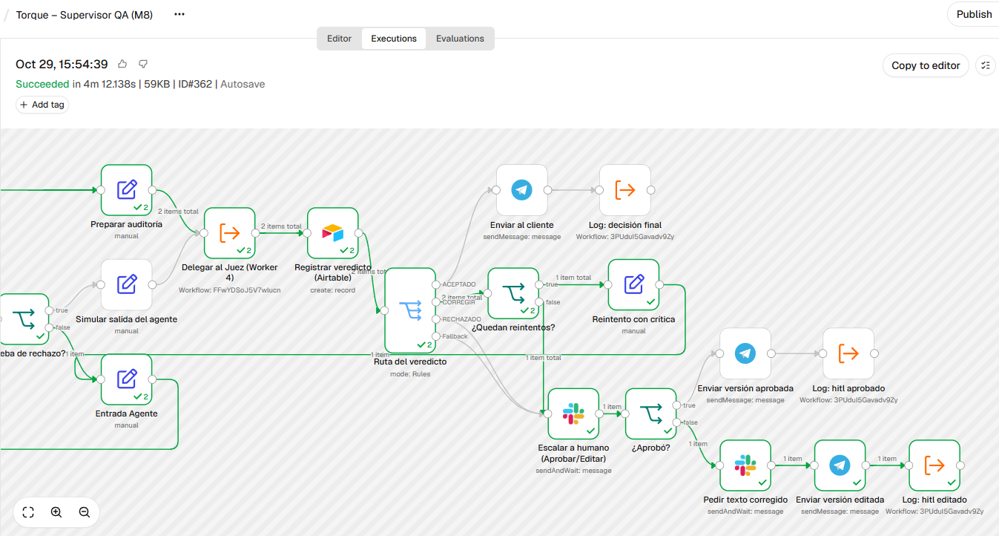
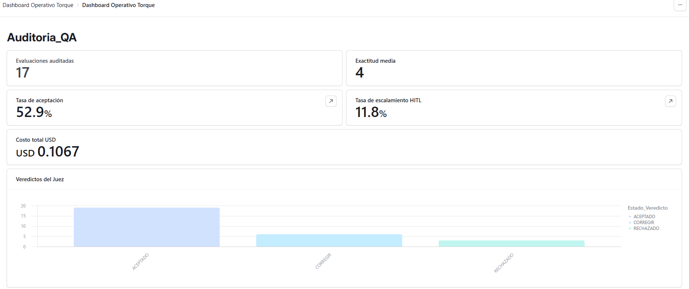
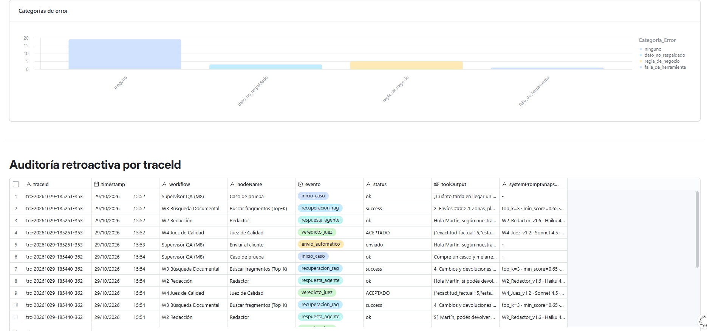

# Checkpoint 9 – Plan de gobernanza, gestión y monitoreo financiero

Documento de entrega: [`PreEntrega_Modulo9_EnzoSaporiti.pdf`](PreEntrega_Modulo9_EnzoSaporiti.pdf)

## Qué se construyó

| Componente | Implementación |
|---|---|
| **traceId** | `trc-AAAAMMDD-HHMMSS-<ejecución>`. Se genera una vez por caso y viaja por el Supervisor, los Workers 2, 3 (vía tool) y 4, los reintentos, Airtable y Slack |
| **Logger central** | `Torque – Worker 5 Logger Central`: recibe el evento, agrega el timestamp y guarda en Airtable `Logs_Trazabilidad`. Se llama con Execute Workflow **sin esperar**, así que no altera el flujo ni suma latencia |
| **Logs JSON** | `traceId`, `timestamp`, `workflow`, `nodeName`, `evento`, `status`, `toolOutput`, `systemPromptSnapshot`, `confidenceScore` |
| **Dashboard operativo** | Airtable Interface sobre `Auditoria_QA` y `Logs_Trazabilidad`: evaluaciones, exactitud media, tasa de aceptación, tasa de HITL, costo, veredictos, categorías de error y auditoría por traceId |
| **Controles deterministas** | En «Veredicto normalizado» (Worker 4): frase obligatoria, cita de fuente, umbral por criticidad (5 en devoluciones y pedidos) y falla de herramienta real |
| **Keys por entorno** | Workspaces de Anthropic `torque-dev` y `torque-prod`, con límite mensual; credenciales separadas en n8n |

## Archivos

| Archivo | Contenido |
|---|---|
| [`supervisor_qa_modulo9_saporiti_enzo.json`](supervisor_qa_modulo9_saporiti_enzo.json) | Supervisor QA con traceId y logs |
| [`worker2_modulo9_saporiti_enzo.json`](worker2_modulo9_saporiti_enzo.json) | Redactor con traceId y log `respuesta_agente` |
| [`worker3_modulo9_saporiti_enzo.json`](worker3_modulo9_saporiti_enzo.json) | RAG con traceId y log `recuperacion_rag` |
| [`worker4_juez_modulo9_saporiti_enzo.json`](worker4_juez_modulo9_saporiti_enzo.json) | Juez con controles deterministas y log `veredicto_juez` |
| [`worker5_logger_modulo9_saporiti_enzo.json`](worker5_logger_modulo9_saporiti_enzo.json) | Logger central |
| [`logs_trazabilidad.csv`](logs_trazabilidad.csv) | Logs de las 3 corridas del Lote 2 |
| [`auditoria_qa.csv`](auditoria_qa.csv) | Veredictos de los Lotes 0, 1 y 2 |

## Números clave (1.200 consultas por mes)

| Concepto | Valor |
|---|---|
| Baseline manual | 120 h y USD 1.200 por mes (USD 1,00 por consulta) |
| TCO con el sistema (escenario piloto, 80% autónomo) | ~USD 235 por mes (IA ~30, plataformas ~85, revisión humana 120) |
| Ahorro y payback | Conservador: USD 605 por mes, payback de 2,5 meses · Piloto: USD 965 por mes, payback de 1,6 meses |

## Evidencia

**Workspaces de Anthropic por entorno:**

**Credenciales DEV y PROD en n8n:**

**Logger central:**

**Controles deterministas del Juez:**

**Logs de un traceId (auditoría retroactiva):**

**Ejecución del caso 362:**

**Dashboard operativo, KPIs y veredictos:**

**Dashboard operativo, categorías y auditoría:**

